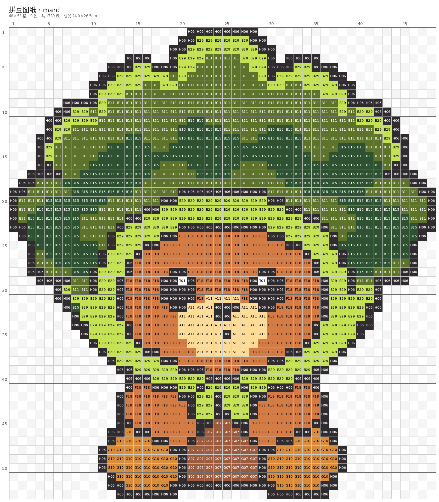
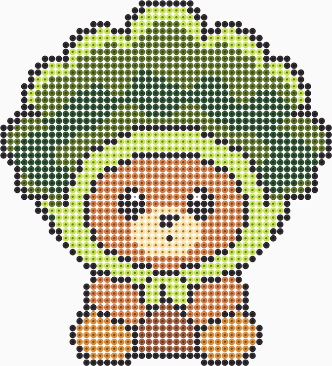
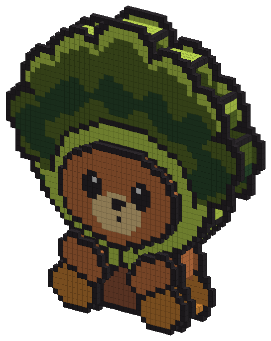
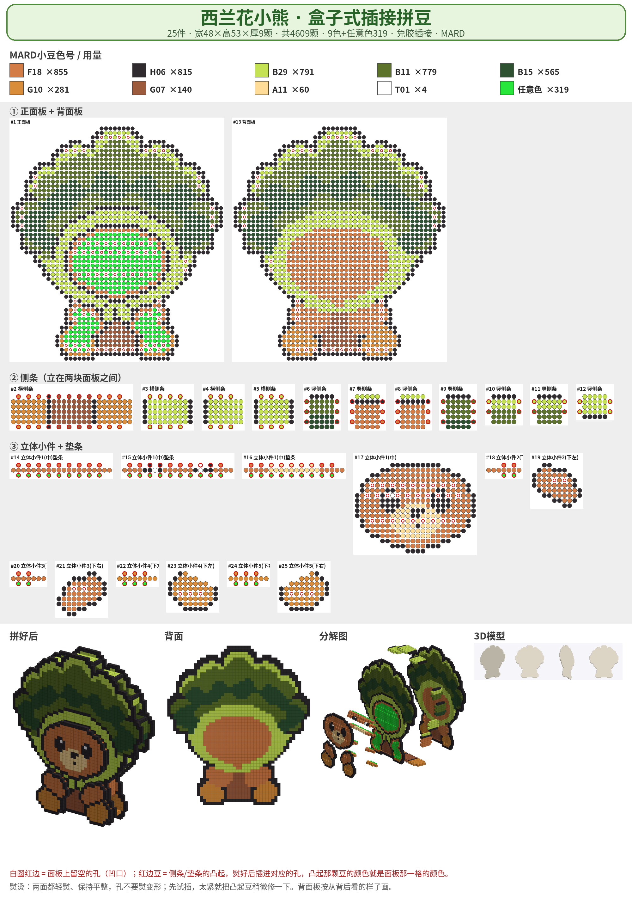
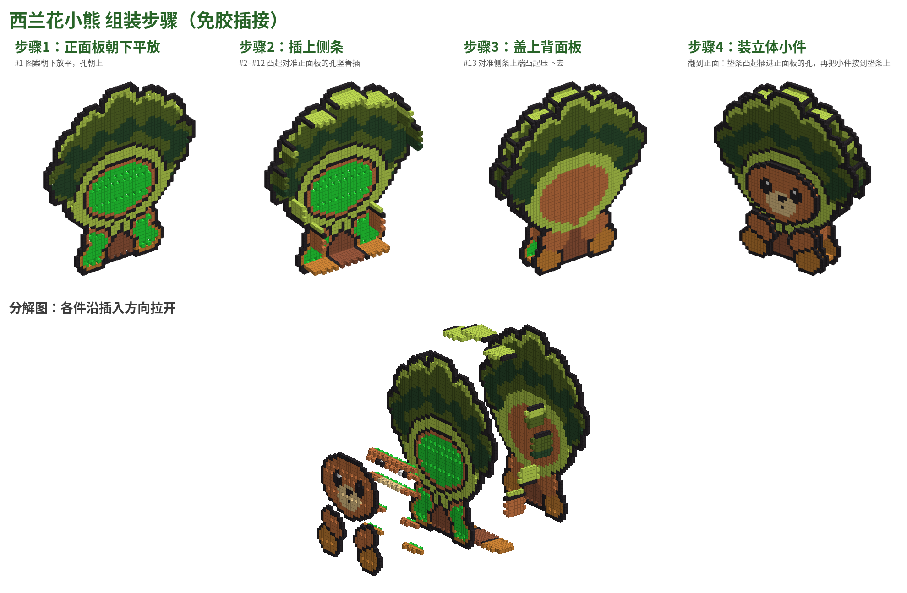

# 拼豆 / pindou

把一张图做成**拼豆**（perler / hama / fuse beads）的仓库：平面图纸和立体免胶插接套件各有一条流水线，共用同一套品牌色卡。

| | 平面图纸 | 立体套件 |
|---|---|---|
| 工具 | [`bead-pattern/`](bead-pattern/) | [`bead3d/`](bead3d/) |
| 输入 | 图片 | 图片，或 glb / obj / stl / ply |
| 产出 | 带色号的网格图、备料清单、可打印 PDF | 免胶插接的零件图。`--style box` 是 MARD 风格盒子（正面板、背面板、侧条凸起/卡槽、凸起小件） |
| 色卡 | 咪小窝 / MARD / COCO / 漫漫 / 盼盼 | 复用 bead-pattern 的色卡，CIEDE2000 配色 |

示例是同一只「西兰花小熊」：先出平面图纸，再出立体盒子套件。图在 [`examples/bear/`](examples/bear/)。

## 平面模式（图片直接出图纸）

`bead-pattern` 把图片像素化，按品牌色卡做 CIEDE2000 色差匹配，写出带色号的网格、每色颗数和 PDF。

```bash
python bead-pattern/scripts/generate.py bead-pattern/assets/samples/mushroom.png \
  --palette mard --mode simple --out output/mushroom-simple

# 高还原
python bead-pattern/scripts/generate.py 图.png --palette mard --mode fine

# 照片：AI 抠图 + 裁到主体（需另装 rembg onnxruntime）
python bead-pattern/scripts/generate.py 照片.jpg \
  --palette mard --mode fine --remove-bg ai --crop-subject --max-side 80
```

常用选项：`--palette manman|mard|coco|mixiaowo|panpan`（命令行默认 manman），`--mode simple|fine`，`--size 29x29`（单板）/ `58x58` / `87x87`，`--max-colors`，`--dither on`（照片渐变）。成品预览：`python bead-pattern/scripts/preview.py output/<目录>`。细节见 [`bead-pattern/README.md`](bead-pattern/README.md)。

## 立体模式（盒子套件）

`bead3d` 把正面角色图（或现成网格）做成可以分片熨烫、再卡在一起的立体套件。`--style box` 是 MARD 那种盒子：

- **正面板 / 背面板**沿剪影；像素画（≤32 色且边长 ≤100）按一像素一颗豆。
- **侧条**夹在两块板之间，每隔一颗豆有 1 颗凸起，板上对应位置留孔。
- **凸起小件**用 `--accessory-colors` 或 `--accessory-box y0:y1,x0:x1` 指定，垫在正面板前面。
- 不传 `--style box` 时走原来的体素切片（圆雕感的分层套件）。

`from-image` 默认调用 Hugging Face Space `tencent/Hunyuan3D-2` 估深度和起伏（可选环境变量 `HF_TOKEN`）。像素画经常得到一块平板，深度会退回宽度的大约 12%（4–6 颗），凸起部位用 `--accessory-colors` / `--accessory-box` 指定。`--no-model` 跳过联网；已有模型用 `from-model`，或 `--shape` 复用缓存的 `shape.glb`。

```bash
python bead3d/bead3d.py from-image char.png --style box \
  --out output/bear-box --title 西兰花小熊 --palette mard \
  --depth 5 --height 36 --accessory-colors F18,A11

python bead3d/bead3d.py from-model model.glb --image char.png \
  --style box --palette mard --out output/model-box --title 角色
```

色卡脚本默认是仓库里的 `bead-pattern/scripts`（相对 `bead3d/bead3d.py` 为 `../bead-pattern/scripts`，色卡文件在 `bead-pattern/palettes`）。换位置时用环境变量 `BEAD_PATTERN_SCRIPTS`，或参数 `--bead-pattern-scripts`。

主要输出（都在 `--out` 里）：`sheet.png`（总图）、`parts_N.png`、`assembly-steps.png`、`preview_iso.png`、`shopping-list.csv`、`summary.json`。参数表见 [`bead3d/README.md`](bead3d/README.md)。

**这套立体件的实物配合还没有试过。** 它是一份按 5mm 豆、熨平后仍在格子上的设计稿；凸起靠摩擦卡住，短侧条、凸起少的位置最容易松。熨的时候轻一点、烫平，让凸起还能塞进孔里。大零件（超过 29 颗）要分多块板。

## 安装

Python 3.10 及以上。图纸和零件图上的中文用 Noto CJK：

```bash
sudo apt install fonts-noto-cjk    # Debian / Ubuntu

python3 -m venv .venv
.venv/bin/pip install -r requirements.txt
```

`requirements.txt` 是立体工具 bead3d 的依赖：`numpy`、`scipy`、`pillow`、`trimesh`、`gradio_client`、`networkx`。平面工具只需要其中的 `numpy` 和 `Pillow`，写在 [`bead-pattern/requirements.txt`](bead-pattern/requirements.txt)。照片 AI 抠图再装 `rembg` 和 `onnxruntime`。

确认命令行能起来：

```bash
python bead3d/bead3d.py --help
python bead-pattern/scripts/generate.py --help
```

## 示例：西兰花小熊

### 平面图纸

| 带色号图纸 | 成品预览（每格一颗带孔的豆） |
|---|---|
|  |  |

### 立体盒子套件

等轴预览：



零件总图（色号、件数、侧条和凸起小件）：



组装步骤：



## 给代理用的技能说明

仓库根目录的 [`SKILL.md`](SKILL.md) 写了平面 / 立体两条怎么选、怎么跑。`bead3d/SKILL.md` 与 `bead-pattern/SKILL.md` 是各自工具的说明。

## 致谢与许可

平面图纸工具来自 [wuZHeBoy/bead-pattern](https://github.com/wuZHeBoy/bead-pattern)（MIT）。本仓库原样保留其 [`LICENSE`](bead-pattern/LICENSE)、说明和色卡；算法代码按该许可证使用。色号与 RGB 的来源说明在 [`bead-pattern/references/source.md`](bead-pattern/references/source.md)（事实型对照，上游数据来自 Zippland/perler-beads）。

`bead3d` 配色时直接调用 bead-pattern 的 `load_palette`、Lab 转换和 CIEDE2000，不另维护一份色卡。屏幕颜色是实物豆的近似值，批量采购以实物色卡为准。
